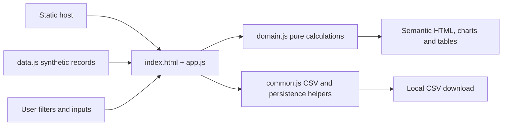

# Architecture

## Request and data flow

## Boundaries

| File                | Responsibility                                                        |
| ------------------- | --------------------------------------------------------------------- |
| `public/data.js`    | Deterministic synthetic domain records                                |
| `public/domain.js`  | Calculations, selection and domain validation, independent of the DOM |
| `public/app.js`     | UI state, events, forms and rendering                                 |
| `public/common.js`  | Formatting, safe output, CSV, charts, dialogs and storage adapters    |
| `public/styles.css` | Responsive layout, focus states and print styles                      |
| `scripts/serve.mjs` | Loopback-only local static server; serves only public assets          |
| `scripts/build.mjs` | Deterministic static asset packaging into dist                        |
| `test/`             | Node unit tests for business rules and error boundaries               |

Each portfolio repository is self-contained. Shared UI conventions are copied intentionally to keep deployment and interview demonstrations independent; a monorepo package would reduce duplication if these became one product suite.

## Why this stack?

Vanilla ES modules keep installation and hosting simple and expose the business logic clearly to reviewers. No framework runtime, external fonts, chart CDN, analytics or network API is required. The tradeoff is manual DOM rendering and event binding. A larger application should introduce components and route-level state.

## State and safety

Finance state consists of the current year, division, quarter and scenario. Each render derives totals and monthly series from the same filtered records. Export uses the same selector. There is no editable account store.

User text is escaped before HTML interpolation. CSV fields are quoted, double quotes are escaped, and potentially executable spreadsheet prefixes are neutralised. Export uses Blob URLs that are revoked after use. The static host has no secrets. Local storage is convenience persistence and not a secure data store.

## Domain assumptions

Linear regression uses the selected months only and clamps negative predictions to zero. No seasonality, backtesting or uncertainty intervals. Figures are operating accounts, not cash flow; taxes and financing are excluded.

## Scaling path

Introduce an authenticated API, schema migrations and transactional persistence before shared editing. Add optimistic concurrency, audit events, server-side validation, paginated queries, integration tests and observability. Keep the pure calculations separate and test them against accepted business examples before migrating the UI.
